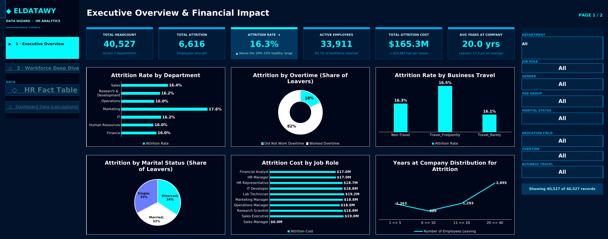
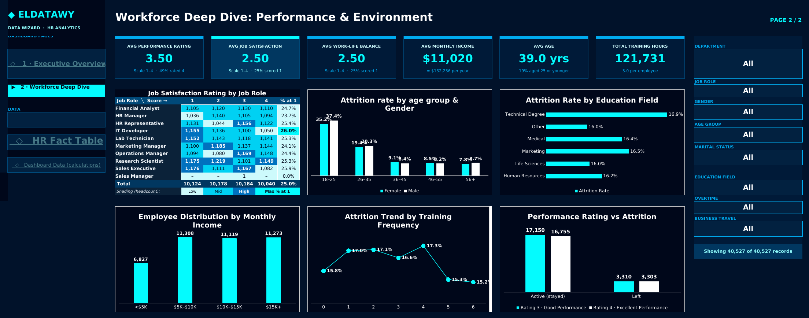

# 👥 HR Analytics Dashboard

**Excel · Power Query · Data Model · Dynamic Formulas**

A two-page Excel dashboard that explains **why employees leave and what it costs**. It covers **40,527 employee records** and helps HR leaders find the employee groups most likely to leave and decide where retention spending should go.

---

## 🎯 Business Questions & Key Insights

| Question | Insight |
|---|---|
| How big is the attrition problem? | **6,616 employees left**, an attrition rate of **16.3%**. That is above the healthy 10%–15% range |
| What does it cost? | **$165.3M** in total attrition cost, or about **$24,983 per leaver** |
| Who is most at risk? | Employees aged **18–25** leave at about **35%–37%**, roughly **4× the rate** of employees aged 36 and over |
| What drives people out? | **82%** of leavers **worked overtime**, the strongest signal in the data |
| Which department is hit hardest? | **Marketing** has the highest attrition, at **17.6%** |
| Are long-tenured staff leaving too? | Yes. **44%** of leavers had **20–40 years** at the company, so experienced staff are leaving too |
| How engaged is the workforce? | Satisfaction and work-life balance both average **2.5 out of 4**, and **25%** of employees gave the lowest score |

---

## 🧭 Dashboard Pages

| Page | Focus | What it shows |
|---|---|---|
| **1 · Executive Overview** | Attrition & financial impact | 6 KPIs (Headcount, Attrition, Attrition Rate, Active Employees, Attrition Cost, Avg Tenure). Attrition broken down by department, age and gender, education field, business travel, overtime and marital status, plus attrition cost by job role |
| **2 · Workforce Deep Dive** | Performance & environment | 6 KPIs (Performance, Job Satisfaction, Work-Life Balance, Monthly Income, Age, Training Hours). A satisfaction heatmap by job role, performance vs. attrition, the income distribution, training frequency and a tenure distribution |

**Filters:** 8 filters (Department, Job Role, Gender, Age Group, Marital Status, Education Field, Overtime and Business Travel). Every KPI and chart on both pages updates with them.

---

## 🛠️ How It's Built

- **Power Query:** cleans and shapes the HR fact table and the `Employee` and `Job` dimension tables.
- **Data model:** a star schema, with the HR fact table linked to the employee and job dimensions.
- **Calculation engine:** a dedicated `Dashboard Data` sheet with filter masks, KPI outputs and chart source tables. Everything is a live formula.
- **UX:**
  - **Navigation:** a side menu with links between the pages.
  - **Context:** a "Showing X of Y records" line that tells you how much the filters have narrowed the data.
  - **Health check:** the attrition rate shows a status against the healthy range.
- **Design:** the **Eldatawy · Data Wizard** dark theme in navy and cyan, shared with the rest of the portfolio.

---

## 🚀 Getting Started

1. Download `HR_Analytics_Dashboard.xlsx`. It is about 15 MB.
2. Open it in **Excel 365 or Excel 2021+**.
3. Start on the **Executive Overview** sheet and use the filters on the right.

---

## 👤 Author

**Abdalrahman Sherif** · *Eldatawy – Data Wizard*
