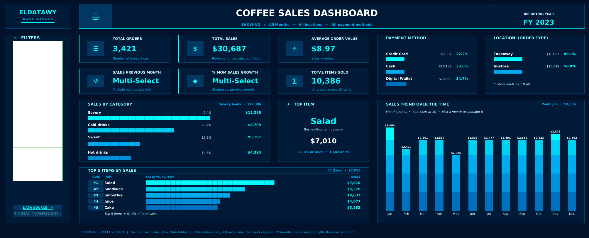

# ☕ Coffee Sales Dashboard

**Excel · Power Query · Data Model · Dynamic Formulas**

An interactive Excel dashboard that tracks a coffee shop's **3,421 transactions in 2023**. In one screen, the owner sees what sells, how customers pay and when sales peak.

---

## 🎯 Business Questions & Key Insights

| Question | Insight (FY 2023) |
|---|---|
| How much did we sell? | **$30,687** in sales from **3,421 orders**, with an average order value of **$8.97** and **10,386 items** sold |
| What drives revenue? | **Salad** is the top item at **$7,010** (22.8% of sales). The **top 5 items** bring in **81.4%** of revenue |
| Which category leads? | **Savory** leads with **40.4%** of sales, ahead of Cold drinks (28.4%) |
| How do customers pay? | The three methods are close: Digital Wallet **34.7%**, Cash **33.0%**, Credit Card **32.2%** |
| Dine-in or takeaway? | Almost even: In-store **50.9%** vs. Takeaway **49.1%** |
| When do sales peak? | **January** is the strongest month at **$3,064**, and monthly sales stay fairly stable through the year |

---

## 🧭 Dashboard Features

- **6 KPI cards:**
  - Total Orders, Total Sales, Average Order Value and Total Items Sold.
  - Sales Previous Month and MoM Growth %. These work when a single month is selected.
- **Visuals:** Sales by Category, Top Item, Top 5 Items ranking, Payment Method split, Order Type split and a 12-month sales trend.
- **Filters:** slicers for Month, Location (order type) and Payment Method. Every KPI and visual updates instantly.
- **Spotlight:** the trend keeps all 12 months visible and highlights the selected month.

---

## 🛠️ How It's Built

- **Power Query:** loads and shapes the raw tables (`Fact_Sales`, `Products`, `Locations`, `Payment Method`, `Date`).
- **Data model:** a star schema, with the fact table linked to its dimension tables.
- **Calculation engine:** a hidden `Dashboard Calc` sheet. It uses `SUMPRODUCT`, `XLOOKUP`, dynamic arrays and named ranges, so every number is a live formula that follows the filters.
- **Pivot tables:** kept on a separate sheet to cross-check the totals.
- **Design:** the **Eldatawy · Data Wizard** dark theme in navy and cyan, shared with the rest of the portfolio.

---

## 🚀 Getting Started

1. Download `Sales_Dashboard.xlsx`.
2. Open it in **Excel 365 or Excel 2021+**, which is needed for `XLOOKUP` and dynamic arrays.
3. Go to the **Eldatawy Dashboard** sheet and use the slicers on the left.

---

## 👤 Author

**Abdalrahman Sherif** · *Eldatawy – Data Wizard*
